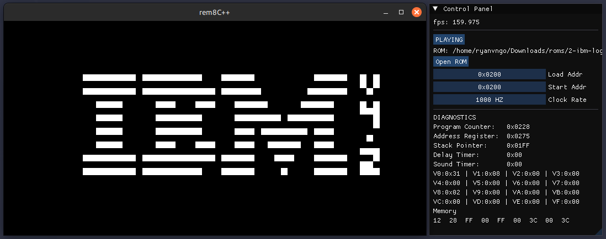

> [!NOTE]
> **Archived — no longer maintained.**
>
> This project was primarily built as transitory work when adjusting my focus to C++ based development. I experimented
> with testing methods, build configuration (for which I had chosen to refactor in recent months before archiving),
> project and code structure, and dependency management. My practices have since evolved, so this repository no
> longer fully represents my approach to software development and I no longer wish to update/maintain it.
>
> Ultimately, this code is preserved as a record of my proficiency at the time.

# rem8C++ - CHIP-8 Emulator

An enhanced C++ version of [rem8C](https://github.com/RyanVNgo/rem8C).

## Downloading and Building
### Download and build the project
```sh
git clone --recurse-submodules https://github.com/RyanVNgo/rem8Cpp.git
cd rem8Cpp
cmake --preset release-ninja
cmake --build --preset rem8Cpp-release-ninja
./build/release/bin/rem8Cpp
```

## Usage
After building the project, you can start using the emulator by running the `rem8C++` executable in the `build/` directory.



### Loading a ROM
To load a ROM:
- click on the **Open ROM** button in the control panel to open the file explorer
- navigate to your ROM and click on it in the explorer, the file path should appear in the top bar
- click on the **Open** button to load it into the emulator
- run the ROM by clicking on the **PAUSED/PLAYING** button in the control panel (it should appear as **PAUSED** at this point).

If desired, you can change the load address and start address when loading a ROM *(because of some current implementation quirks,
it is recommended to leave these at their default values)*.

You can also change the clock rate of the emulator between 0hz - 20000hz with the **Clock Rate** drag slider.


### Diagnostics in the Control Panel
- `fps`: frames per second*
- `Program Counter`: Current location of the program counter
- `Address Register`: Current value stored in the addres register (I Register)
- `Stack Pointer`: Current location of the stack pointer
- `Delay Timer`: Current value of the delay timer
- `Sound Timer`: Current value of the sound timer*
- `V0 - VF`: The values stored in each of the 16 data registers
- `Memory`: Displays the 8 bytes of data at and following the current instruction (PC to PC + 8)

<sub>
 * - There is no sound
</sub>
